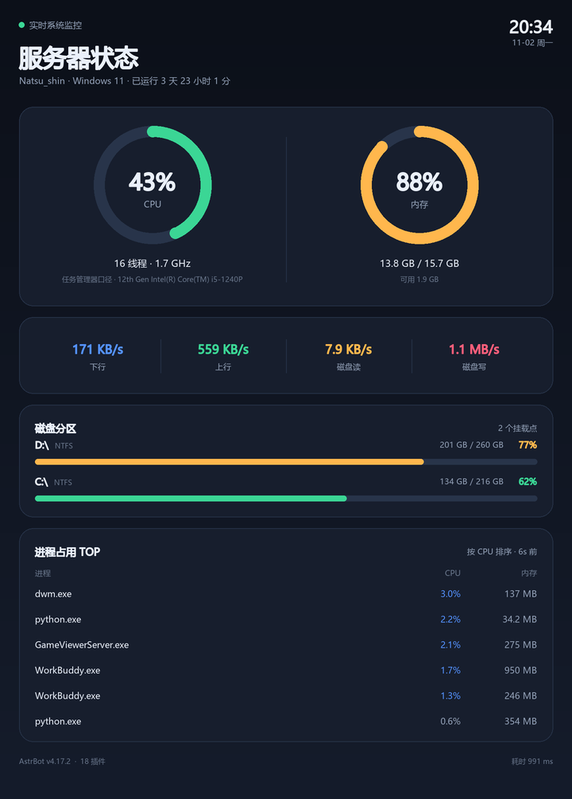
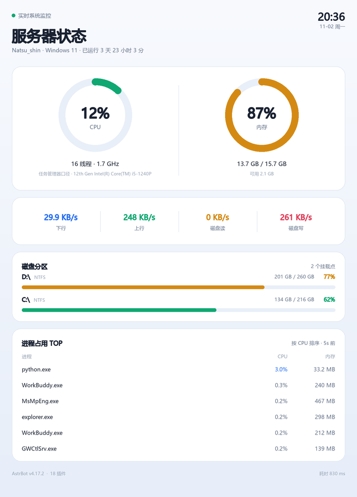

# astrbot_plugin_server_status

在聊天会话中发送一条指令，机器人返回一张**竖屏手机版服务器实时状态卡片图片**：
CPU、内存、磁盘分区、网络速率、磁盘 IO、进程占用 TOP、运行时长等一图流。

版式按手机阅读设计（720 宽窄长卡片），在聊天窗口里点开一屏读完，不用横向拖动。
深色 / 浅色两套主题，纯 Pillow 本地渲染 —— 不需要 Chromium / wkhtmltoimage，冷启动 < 100ms。

## 效果预览

| 深色主题 | 浅色主题 |
| --- | --- |
|  |  |

## 使用方法

在任意已接入的聊天平台发送：

```
/status  /sysinfo
/状态  /服务器状态  /状态查询  /系统状态  /运行状态  /主机状态  /服务器监控
```

机器人将回复一张状态卡片图片。所有指令都互为别名，无需额外配置。

## 安装

1. 将本目录放入 AstrBot 插件目录：

```bash
cd AstrBot/data/plugins
git clone https://github.com/Summer-Ever/astrbot_plugin_server_status.git
```

2. 安装依赖（AstrBot WebUI 安装插件时会自动执行）：

```bash
pip install -r requirements.txt
# 即 psutil + Pillow
```

3. 在 WebUI「插件」页重载插件，或在聊天中直接发送 `/status` 验证。

### Linux 中文字体

若图片中中文显示为方块 `□□□`，安装任意一款中文字体后重启：

```bash
# Debian / Ubuntu
sudo apt-get install -y fonts-noto-cjk
# 或
sudo apt-get install -y fonts-wqy-microhei

# CentOS / RHEL / Fedora
sudo yum install wqy-microhei-fonts
```

也可以在插件配置 `font_path` 中直接指定一个 `.ttf/.ttc/.otf` 字体文件的完整路径。
插件会自动查找 Windows（微软雅黑）/ macOS（苹方）/ Linux（Noto CJK、文泉驿、Droid Sans Fallback）等常见中文字体。

## 配置项

在 WebUI「插件管理 → 服务器状态监控 → 插件配置」中可视化调整：

| 配置 | 默认 | 说明 |
| --- | --- | --- |
| `render_mode` | `image` | 返回图片还是纯文本；渲染失败会自动回落为文本 |
| `theme` | `dark` | 深色 / 浅色主题 |
| `accent_color` | 空 | 主题强调色（十六进制，如 `#548CFF`） |
| `send_mode` | `base64` | 图片以 base64 还是本地文件方式发送 |
| `admin_only` | `false` | 是否仅管理员可用 |
| `cooldown_seconds` | `5` | 同一会话的查询冷却时间 |
| `cpu_metric` | `utility` | CPU 占用统计方式：`utility`（任务管理器口径，推荐）或 `time`（时间占比） |
| `sample_interval` | `0.5` | 系统采样间隔（秒），用于计算瞬时速率 |
| `show_disk_partitions` / `max_disk_partitions` | `true` / `4` | 磁盘分区列表 |
| `show_processes` / `process_top_n` | `true` / `5` | 进程占用 TOP |
| `process_refresh_interval` | `60` | 进程缓存刷新间隔（秒） |
| `image_width` | `720` | 图片宽度（竖屏设计宽度，手机显示最佳） |
| `render_scale` | `2.0` | 超采样倍率（抗锯齿精度） |
| `font_path` | 空 | 自定义字体路径 |
| `footer_text` | 空 | 自定义页脚文字 |

## 设计说明

- **速率类指标（CPU / 网络 / 磁盘 IO）实时计算**：每次查询做一次 0.5s 的双采样取差值，
  保证数值是"现在"的瞬时值，而不是开机以来的平均值。
- **CPU 占用默认用任务管理器同款口径（% Processor Utility）**：Windows 8+ 的任务管理器显示的不是
  时间占比，而是按频率折算的 Utility；混合架构 CPU（P 核 + E 核）上两者能差 5~7 倍（实测同机 4% vs 30%）。
  默认 `utility` 与任务管理器对齐；想看与 top / htop / 宝塔一致的时间占比可改回 `time`。
- **CPU 读取不占性能**：无任何后台线程，只在查询的那 0.5 秒内采样，平时完全空闲。
- **CPU 占用用 `cpu_times()` 自算差值**：`psutil.cpu_percent(interval=None)` 依赖进程内的全局时间戳缓存，
  只要别的插件或 AstrBot 面板在采样窗口内也调用一次，基准点就会被重置，导致稳定读出 0%。
  这里改用无状态的 `cpu_times()` 计算忙碌时间占比，不受其他代码干扰。
- **频率显示为"当前 / 最高"**：现代 CPU 空闲时会主动降频，`0% + 1.5GHz` 是正常待机状态，
  同时给出最高频率才能看出降频关系。
- **进程 TOP 走后台缓存**：Windows 上遍历一次进程表需要 1~2 秒，直接放在查询路径中会让用户等 5 秒以上。
  插件启动后会用后台任务定期刷新进程缓存（默认 60s），查询时直接读缓存、标注缓存年龄，
  因此主路径响应时间稳定在 1 秒内。
- **base64 发图**：默认将 PNG 以 base64 内嵌发送，协议端（NapCat 等）与 AstrBot 不在同一台机器时也能正常出图；
  如个别平台异常可在配置中切换为 `file` 模式。

## 致谢

设计实现过程中参考了下列同类插件的功能思路与经验（如中文字体自动查找、速率双采样等）：

- [yanfd/astrbot_plugin_server](https://github.com/yanfd/astrbot_plugin_server)
- [BB0813/astrbot_plugin_sysinfoimg](https://github.com/BB0813/astrbot_plugin_sysinfoimg)
- [SinkAbyss/astrbot_plugin_sysinfo_self](https://github.com/SinkAbyss/astrbot_plugin_sysinfo_self)

本项目代码为独立实现，采用 [MIT License](./LICENSE)。

## 更新日志

- `v1.1.1` CPU 占用改用任务管理器同口径（% Processor Utility，可配置），修复与任务管理器数字对不上的问题；采样零后台开销。
- `v1.1.0` 改为竖屏手机版式；修复 CPU 占用偶发显示 0% 的采样问题；频率改为「当前 / 最高」显示；
  移除交换分区与系统概况区块。
- `v1.0.0` 首个版本：环形仪表状态卡片、中文指令别名、深浅主题、进程 TOP 缓存、文本回落。
